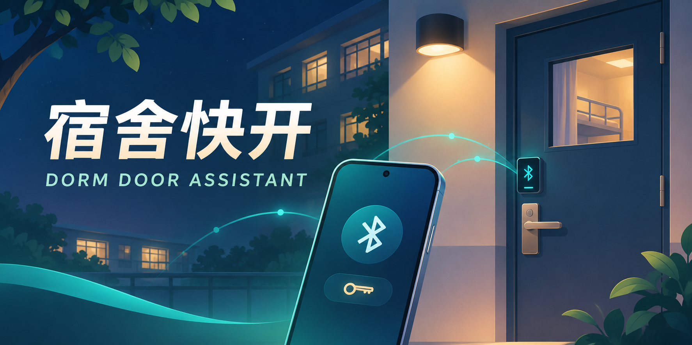

<div align="center">

# 🔑 宿舍快开



**本人授权门锁的安卓蓝牙辅助工具**


[下载与版本说明](https://github.com/Leon-Cjl/dorm-native-open/releases) · [自助配置说明](self-service/README.md)

</div>

---

## ⚖️ 法律声明与免责条款

> 本声明依据《中华人民共和国网络安全法》《中华人民共和国个人信息保护法》《中华人民共和国刑法》《中华人民共和国民法典》制定，自项目发布之日起适用。**使用本应用即视为已阅读并同意以下全部条款。**

### 一、非官方性质

本项目为个人开发的非官方工具，与任何学校、门锁厂商、物业管理方无任何隶属、授权或合作关系。

依据：
- **《民法典》第1165条**：行为人因过错侵害他人民事权益造成损害的，应当承担侵权责任。
- **《民法典》第1194条**：网络用户、网络服务提供者利用网络侵害他人民事权益的，应当承担侵权责任。

### 二、使用前提与授权要求

**本应用不提供、不绕过任何门锁的认证机制。** 用户必须已通过合法渠道获得相应门锁的有效授权，方可使用本应用。本应用仅作为已获授权用户的蓝牙辅助操作界面。

依据：
- **《刑法》第285条第2款**：违反国家规定，获取计算机信息系统中存储、处理或传输的数据，或对其实施非法控制，情节严重的，处三年以下有期徒刑或者拘役，并处或单处罚金；情节特别严重的，处三年以上七年以下有期徒刑，并处罚金。
- **《民法典》第1198条**：经营场所的经营者、管理者未尽到安全保障义务，造成他人损害的，应当承担侵权责任。因第三人行为造成他人损害的，由第三人承担侵权责任；经营者、管理者未尽到安全保障义务的，承担相应的补充责任。
- **《网络安全法》第27条**：任何个人和组织不得从事非法侵入他人网络、干扰他人网络正常功能、窃取网络数据等危害网络安全的活动；不得提供专门用于从事此类活动的程序、工具。

> **未经授权使用他人门锁可能构成违法行为。使用者需确保遵守所在学校的宿舍管理规定和相关法律法规，因不当使用造成的后果由使用者自行承担。**

### 三、个人信息保护

应用仅在本地存储用户宿舍信息，不上传任何服务器。`.dormkey` 文件的签名仅为本项目迁移校验，不是学校发卡或门锁授权。公开工具包不含签名私钥，不接受任意房号或自造签名。

依据：
- **《个人信息保护法》第13条**：处理个人信息须取得个人同意。
- **《个人信息保护法》第14条**：同意须由个人在充分知情的前提下自愿、明确作出。
- **《个人信息保护法》第15条**：个人有权撤回其同意，处理者应提供便捷的撤回方式。
- **《个人信息保护法》第17条**：处理前应告知处理者名称、联系方式、处理目的、方式、种类、保存期限及权利行使方式。
- **《个人信息保护法》第28条**：行踪轨迹等属于敏感个人信息，须具有特定目的和充分必要性，并采取严格保护措施。
- **《个人信息保护法》第51条**：应采取加密、去标识化等安全技术措施防止未经授权的访问及个人信息泄露。
- **《网络安全法》第41条**：收集使用个人信息须遵循合法、正当、必要原则，公开收集规则，明示目的、方式和范围，并经被收集者同意。
- **《网络安全法》第44条**：任何个人和组织不得窃取或者以其他非法方式获取个人信息。

### 四、工具安全边界

- 预连接不写唤醒或开锁命令；实际开锁仍需当前有效授权。
- 系统终止进程后需重新打开应用，无开机自启。
- 公开工具包不含签名私钥，不接受任意房号或自造签名。
- 请勿上传门锁授权文件或私人签名密钥到任何公开场所。

依据：
- **《网络安全法》第27条**：不得提供专门用于从事侵入网络、干扰网络正常功能及防护措施、窃取网络数据等危害网络安全活动的程序、工具。
- **《刑法》第285条第3款**：提供专门用于侵入、非法控制计算机信息系统的程序、工具的，情节严重的，依照第285条第2款的规定处罚。

### 五、功能限制声明

以下功能尚未完成真实环境验证，不保证在所有设备上可用：

- ⏳ 长时间锁屏保持
- 👤 另一名新用户导入流程
- 🤖 自动接近功能

### 六、责任归属

使用者因不当使用本应用造成的任何后果，由使用者自行承担。开发者不对应用的可用性、准确性和安全性作任何担保。

依据：
- **《网络安全法》第74条**：违反本法给他人造成损害的依法承担民事责任；构成违反治安管理行为的依法给予治安管理处罚；构成犯罪的依法追究刑事责任。

---

## 功能概览

| 功能 | 说明 |
|---|---|
| 🔵 原生蓝牙开门 | 手动按钮开门，不依赖网络 |
| 🔄 自动预连接 | 允许附近设备后主动预连接，失败按 2/4/6 秒间隔重试 |
| 📋 本地账号管理 | 管理本人宿舍信息，数据仅存本机 |
| 🏠 首页状态面板 | 集中显示开门及连接状态 |
| 🔔 前台服务 | 退到后台后由 connectedDevice 前台服务继续维持连接 |

## 首次取得文件

公开包包含 `onboarding/给AI的指令.txt` 和 `session-export.cjs`。本人登录电脑微信小程序后，AI 读取当前学校/学号/宿舍及对应页面证据，只读查询该账号已有权限，生成 `.dormrequest`；维护者运行 `tools/issue-dormkey.cjs` 命令自动签出 `.dormkey`，再由本人手机选中文件直接绑定。

> 此流程仍需维护者的本地工具自动签发并返回文件，尚非公众一键登录。工具不提供远程身份认证；只填学号不是登录。

## 构建与交付

```powershell
.\build.ps1 -Public    # 公众 APK，不预置任何人的授权
.\build.ps1 -Personal  # 个人 APK，含本人资料，不能公开
```

## 测试

```powershell
node tests/onboarding-tests.cjs     # 新流程测试
node tools/verify-port.cjs          # 校验迁移/协议及当前 APK
```

## 参与开发

由 [Leon-Cjl](https://github.com/Leon-Cjl) 主导，AI 编程助手 Claude、Codex、Gemini 和 DeepSeek 参与了代码编写。

## 许可证

代码以 [MIT](LICENSE) 许可证开源。

## 相关项目

[Leon 的项目主页](https://github.com/Leon-Cjl) · [校园电费](https://github.com/Leon-Cjl/campus-dianfei) · [工大学伴](https://github.com/Leon-Cjl/gongda-xueban) · [奶蛙版](https://github.com/Leon-Cjl/gongda-xueban-naiwa) · [宿舍快开](https://github.com/Leon-Cjl/dorm-native-open)
